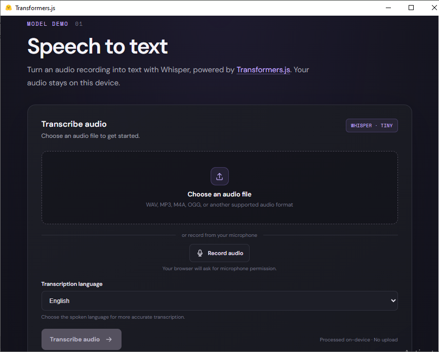

# Transformers.js Playground



A desktop app built with Tauri 2 and vanilla JavaScript for trying machine-learning models in the browser. The first demo transcribes audio with Transformers.js and Whisper.

## Speech-to-text demo

- Select an audio file or record a clip with your microphone.
- Choose one of Whisper's 99 supported transcription languages. English is selected by default.
- Preview the audio, transcribe it, copy the result, or export it as a `.txt` file.
- Transcription runs on-device. Tauri builds include the quantized Whisper model (about 45 MB) and the ONNX Runtime Web JavaScript and WebAssembly files (about 26 MB) in the app bundle.

The app uses `Xenova/whisper-tiny`. Audio recordings and selected files are processed locally and are not uploaded by the app. Once built, transcription does not need to download the model or runtime from the internet.

## Development

Requirements:

- Node.js 22 or later
- pnpm
- Rust and the platform prerequisites for [Tauri 2](https://v2.tauri.app/start/prerequisites/)

Install JavaScript dependencies and start the desktop app:

```bash
pnpm install
pnpm tauri dev
```

Create a production build:

```bash
pnpm tauri build
```

The frontend is plain JavaScript modules; there is no webpack or other frontend bundler. An import map in `src/index.html` resolves the ONNX Runtime modules imported by the local Transformers.js bundle.

Before `tauri dev` or `tauri build`, the configured hook runs `scripts/download-whisper-model.mjs`. It downloads the model files from a pinned Hugging Face revision into `src/models/` and copies the Transformers.js and ONNX Runtime bundles from their pinned npm dependencies into `src/vendor/`; these generated directories are included in the Tauri frontend bundle and ignored by Git. The first setup needs an internet connection to download the model, and `pnpm install` installs the build-time dependencies.

## Notes

- Microphone recording requires microphone permission in the app or operating system.
- Exporting in the Tauri app uses the native Save As dialog. In a regular browser, the transcript downloads as a text file.
- `withGlobalTauri` is enabled in `src-tauri/tauri.conf.json` for the dialog and filesystem APIs used by the app.
- To pass command-line arguments to the development app: `pnpm tauri dev -- -- <arguments>`.
- To inspect runtime errors, open the WebView developer tools from the app window.

On Fedora, the following Tauri system packages may be needed:

```bash
sudo dnf install libsoup3-devel javascriptcoregtk4.1-devel webkit2gtk4.1-devel
```
